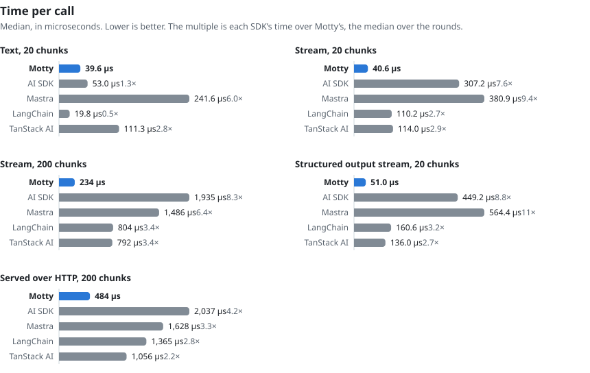
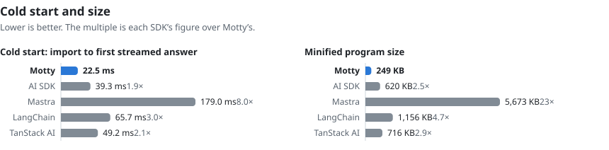

# Motty SDK

A motty is a gateway with real logic between LLMs and agents. To its caller it is just another
model: a chat request in, an answer out. Inside, it is a small program that decides which model
to call, in what order, with what changes. It has no weights: it is routing and policy.

The SDK is the open-source toolkit for building motties. A caller changes the URL and the model
name, and keeps its format: a motty is served over the Chat Completions, Responses and Messages
APIs. The logic is plain TypeScript, the same code self-hosted and on the Hub, a service that hosts
motties. It is not a backend framework and not an agent framework.

## Status

Pre-release. Every package is at version `0.0.0` and none is published to npm yet. Bun only:
`serve`, the adapters, the bundler and the test runner are Bun's. A motty's own code uses
web-standard APIs and the async context. No other runtime is promised.

## Quick start

Until the packages are published, a motty is written inside this repository, as a workspace member
beside the examples.

A motty is a default export. This one sends a request without tools to the first of two small
models to answer, and any other to a strong model, retried twice, with a second one behind it:

```ts
// src/motty.ts
import { fallback, model, motty, race, retry } from "@mottyjs/core";

export const mini = model("openai/gpt-5-mini");
export const gpt = model("openai/gpt-5");
export const haiku = model("anthropic/claude-haiku");
export const sonnet = model("anthropic/claude-sonnet");

export default motty({ name: "coder" })
  .route(({ request }) => (request.tools.length === 0 ? "quick" : "standard"), {
    quick: ({ prompt }) => race(mini, haiku).complete(prompt),
    standard: ({ prompt }) => fallback(retry(sonnet, 2), gpt).complete(prompt),
  });
```

A serve file makes it a server. The provider keys are read from the environment and stay with the
host:

```ts
// src/serve.ts
import { serve } from "@mottyjs/serve";
import { anthropic } from "@mottyjs/adapters/anthropic";
import { openai } from "@mottyjs/adapters/openai";
import coder from "./motty";

export default serve(coder, ({ OPENAI_KEY, ANTHROPIC_KEY }) => ({
  models: [
    openai({ key: OPENAI_KEY }),
    anthropic({ key: ANTHROPIC_KEY }),
  ],
  limits: { durationMs: 120_000, calls: 10, afterResponseMs: 30_000 },
  report: (record) => console.log(JSON.stringify(record)),
}));
```

`bun run src/serve.ts` starts it. A client of any of the three APIs then points its base URL at
the server and calls it as it would a model.

A test scripts the models and runs the whole request without the wire:

```ts
// test/coder.test.ts
import { expect, test } from "bun:test";
import { fake, on, run } from "@mottyjs/test";
import coder, { haiku, mini } from "../src/motty";

test("a short question without tools goes to the quick tier", async () => {
  const models = fake(
    on(mini, "quick reply"),
    on(haiku, "quick reply"),
  );

  const { route, answer } = await run(
    coder,
    { text: "What does git stash do?" },
    { models: [models] },
  );

  expect(route).toBe("quick");
  expect(await answer.text()).toBe("quick reply");
});
```

## Speed

The same calls are made through Motty and through four other SDKs: the Vercel AI SDK, Mastra,
LangChain JS and TanStack AI. The upstream is a stub that answers inside the process, so a
figure is what an SDK adds to a call, never a model's own latency. A gate runs the comparison
on every change and fails when a rival does not take more than 1.1 times Motty's time, or when
its program is not larger. One entry is listed as a known loss and is held to the opposite: it
fails once Motty is ahead there, so the list cannot go stale.

<picture>
  <source media="(prefers-color-scheme: dark)" srcset=".github/assets/benchmark-time-dark.svg">
  
</picture>

<picture>
  <source media="(prefers-color-scheme: dark)" srcset=".github/assets/benchmark-start-dark.svg">
  
</picture>

Each rival's cost as a multiple of Motty's, the median over the rounds. Above one, Motty is
ahead:

| | Motty | AI SDK | Mastra | LangChain | TanStack AI |
| --- | ---: | ---: | ---: | ---: | ---: |
| Text, 20 chunks | 38.6 µs | 1.42× | 6.67× | 0.53× | 3.03× |
| Stream, 20 chunks | 40.4 µs | 8.60× | 11.63× | 2.91× | 3.11× |
| Stream, 200 chunks | 259 µs | 9.26× | 7.83× | 3.79× | 3.71× |
| Structured output stream, 20 chunks | 52.9 µs | 10.05× | 13.64× | 3.40× | 2.86× |
| Served over HTTP, 200 chunks | 460 µs | 4.51× | 3.48× | 2.93× | 2.30× |
| Cold start, import to first streamed answer | 21.5 ms | 1.94× | 8.56× | 3.09× | 2.33× |
| Minified program size | 237 KB | 2.61× | 23.89× | 4.87× | 3.02× |

- **Motty is behind in one place:** a non-streamed text call against LangChain. Motty always
  reads a stream upstream, and that is the entry the gate lists as a known loss.
- **Measured on 2026-10-11** on an Apple M4 Max with Bun 1.4.2, against `ai` 7.0.137,
  `@mastra/core` 1.75.0, `@langchain/openai` 1.6.2 and `@tanstack/ai` 0.68.0: 15 rounds of
  20,000 chunks after one discarded, the SDKs taking turns in one process.
- **To measure it yourself:** `bun gates/bench/rivals/compare.ts` prints the same figures with
  each call's 99th percentile.

## Packages

| Package | Kind | Holds |
| --- | --- | --- |
| [`@mottyjs/core`](packages/core) | Core | The builder, model calls, `fallback`, `race`, `retry`, `timeout`, answers, error classes, types |
| [`@mottyjs/store`](packages/store) | Plugin | Key-value storage that outlives a request |
| [`@mottyjs/decision`](packages/decision) | Plugin | Decision models and their questions |
| [`@mottyjs/auth`](packages/auth) | Plugin | A part that requires an identified caller |
| [`@mottyjs/settings`](packages/settings) | Plugin | Typed settings a host may override |
| [`@mottyjs/test`](packages/test) | Test kit | Scripted models, in-memory storage, `run` |
| [`@mottyjs/serve`](packages/serve) | Host side | `serve`, `mount` and the three wire APIs. Never in a bundle |
| [`@mottyjs/adapters`](packages/adapters) | Host side | Model providers, Redis storage, and auth: `jwt`, `bearer`, or the host's own object with a `verify` function |

Only the core has no dependencies. Plugins compile into the motty's bundle; the host side never
does.

## Examples

Three motties, each with a README that follows one request through it:

- [`examples/coder`](examples/coder) sends coding-agent requests to the cheapest model that can
  handle them.
- [`examples/council`](examples/council) puts a hard question to models of three providers and
  has a stronger model merge what they said, within a spending limit.
- [`examples/desk`](examples/desk) is a customer-support desk served as one model.

The reasons behind the design, and what was rejected, are in [ARCHITECTURE.md](ARCHITECTURE.md).
The core's own plan is in [CORE.md](CORE.md).

## Running the checks

```sh
bun install
bun run lint
bun run typecheck
bun test
```

- The storage adapter is tested against a real server, or not at all. Start one with
  `podman compose up -d --wait`, or the same with `docker`, and run the tests with
  `REDIS_URL=redis://127.0.0.1:6379`.
- `bun run test:live` makes real calls that cost money. It needs provider keys in `.env`, and a
  provider without a key is skipped.

## Provider adapters

How far each model provider's adapter is proven differs, and the difference is stated here:

- **Against the live API:** `openai`, `anthropic`, `openrouter`, `typesafe`.
- **A live test is written and runs when that provider's key is set:** `mistral`, `together`,
  `fireworks`.
- **Only against stubs built from the vendor's reference so far:** `deepseek`, `moonshot`, `zai`,
  `dashscope`, `minimax`, `groq`, `ollama`, `local`.

## Security

How to report a vulnerability, and what the SDK does and does not guard, is in
[SECURITY.md](SECURITY.md).

## Contributing

See [CONTRIBUTING.md](CONTRIBUTING.md).

## Licence

[Apache-2.0](LICENSE). Copyright 2026 Skrrt LLC.
