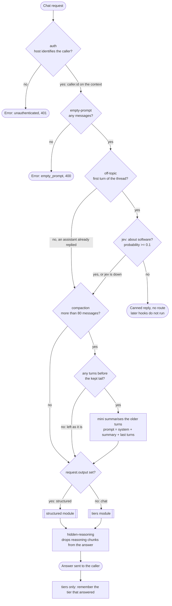
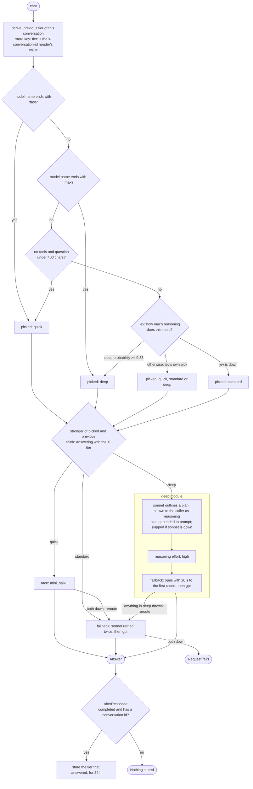
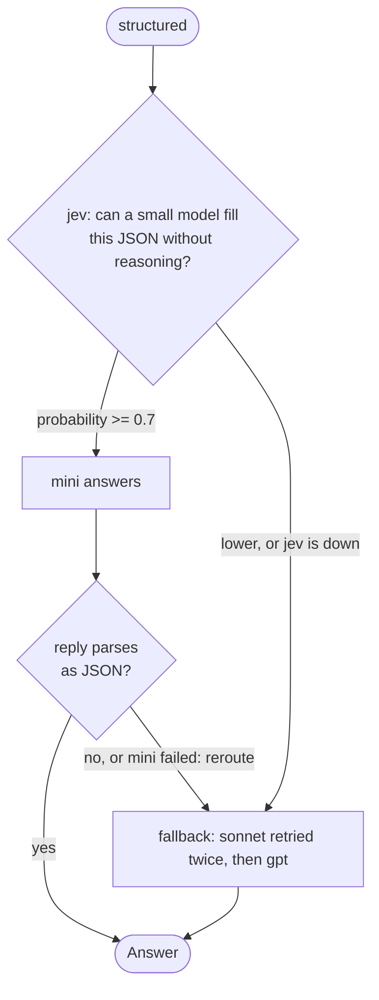

# coder

Sends coding-agent requests to the cheapest model that can handle them. This page follows one
request through the motty; the rules behind each step are in
[ARCHITECTURE.md](../../ARCHITECTURE.md).

## The whole request

The root in `src/motty.ts` uses five parts. Four are gates that run first: `auth`, `empty-prompt`,
`off-topic` and `compaction`. The request then goes to one of two modules by whether the caller
asked for JSON, and the fifth, `hidden-reasoning`, runs on the answer.

- `auth` holds no check of its own. The host's adapter proves the caller: `jwt` in `src/serve.ts`
  here. When the host gives none, the request is rejected as unauthenticated.
- The gates change `prompt` or end the request; `request` stays as the caller sent it.
- An off-topic refusal is an ordinary reply, not an error, because an agent shows an error as a
  failure of its own.
- The summary keeps the system message and a tail that starts at a user message, so a tool result
  is never separated from its call.
- `hidden-reasoning` removes the answering model's reasoning only. Progress sent with `think` is
  not part of the answer and still reaches the caller.

## Chat: the tiers module

`src/modules/tiers` picks one of three tiers. Cheap rules run first, the decision model only when
none of them applies, and a conversation never moves to a weaker tier than it already reached.

- Staying on the stronger tier keeps the provider's prompt cache, which a move to a cheaper model
  mid-conversation would throw away.
- The deep threshold is low on purpose: a weak answer to a hard request costs more than a strong
  answer to an easy one.
- After a reroute, `route` is the entry that answered, so that is the tier remembered.

## JSON: the structured module

`src/modules/structured` answers requests that carry an output schema. They never reach the tier
choice.

- The small reply is read before any of it is sent, so one that was cut off is answered again by
  the strong model instead of reaching the caller's parser.

## Where the numbers come from

Every threshold above is a default in `src/settings.ts`, and the host may override it in
`src/serve.ts`, except the retry count, which is fixed in the code. The models are named in
`src/models.ts`; `jev` is the decision model.
