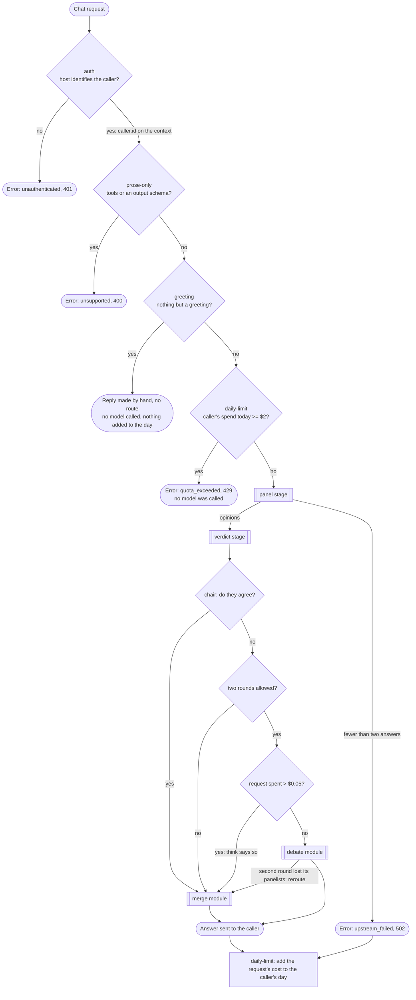
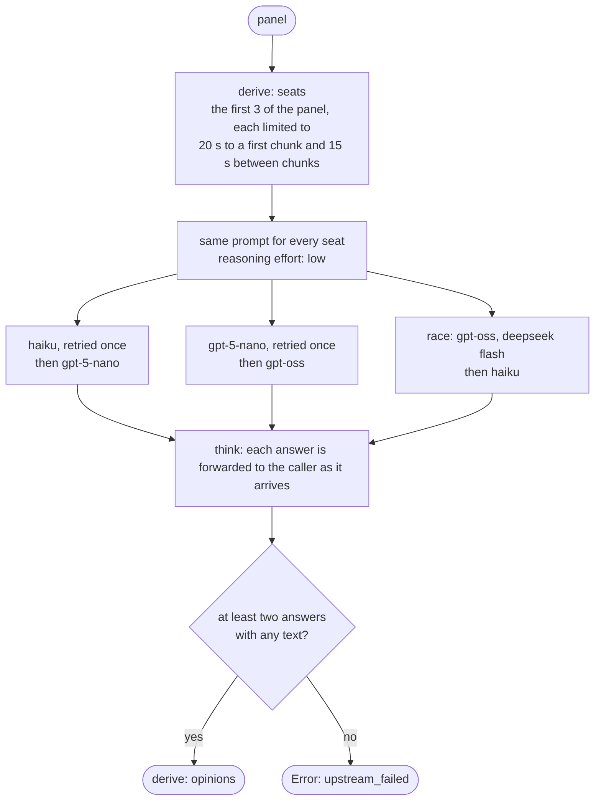
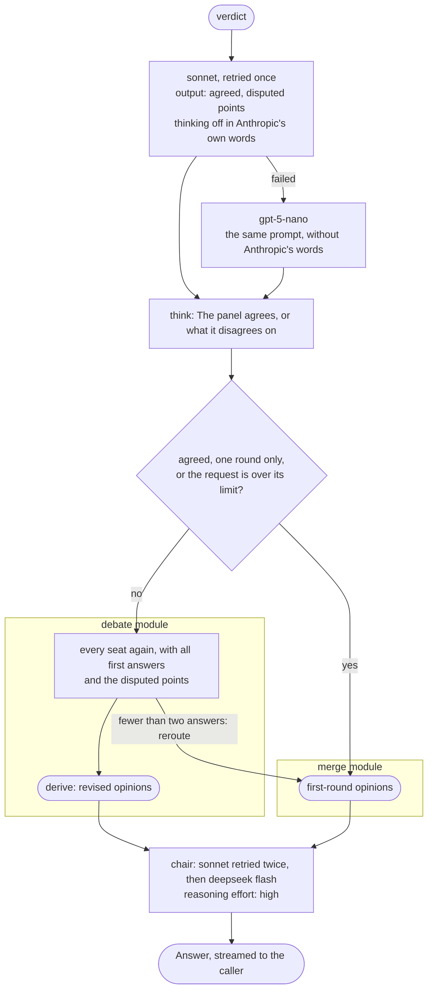

# council

Puts a hard question to models of three providers, lets the caller watch them answer, and has a
stronger model merge what they said, within a spending limit. This page follows one request
through the motty; the rules behind each step are in [ARCHITECTURE.md](../../ARCHITECTURE.md).

## The whole request

The root in `src/motty.ts` is the whole path, read top to bottom. Three gates run first:
`prose-only`, `greeting` and `daily-limit`. Two stages then run for every request that passed:
`panel` asks the seats and `verdict` has the chair compare what they said. The verdict picks one of
two entries, `merge` or `debate`, and after the response `daily-limit` adds what the request cost
to its caller's day.

- A greeting is answered before `daily-limit` is reached, so its check of the day's spend never
  runs. Its `afterResponse` still does: after an early answer a hook is left out, and recorded
  as `unreached`, only when a `derive` or the route of its own chain, its parts included, never
  ran, and what `daily-limit` reads was made before the greeting. It finds no cost to add, so a
  greeting costs neither a model call nor a store command.
- Several answers merge into prose, never into one tool call or one object of a caller's schema, so
  such a request is refused in words the caller can act on instead of answered wrongly.
- `panel` and `verdict` are parts that derive a value, not entries: every request passes both, and
  a route is for where requests differ. The table has only the two ways a request can end.
- The stages share values by using the same part. `debate` and `merge` use `panel` to read
  `opinions` and `seats` with their types; a part is applied once on a path, so the panel is never
  asked again for it. Either module run alone asks the panel itself.
- A request that failed still paid for its calls, so the spend is written for every outcome.

## The panel

`src/modules/panel` asks every seat the same question at once. `src/models.ts` composes the seats.

- Each seat starts at another provider and falls back to a third, so one provider's outage costs
  no seat and two leave a quorum.
- A seat that failed or said nothing is left out, and the others are not asked to wait for it.
- One prompt goes through a whole seat, its fallback included. A reasoning effort that a model
  does not take is left out of that call and named in the call's `warnings`, so it fails no seat.
- The first panelist to start is read live; the others reach the caller whole, in the order they
  were offered. Progress is not part of the answer.

## The verdict and the two ways to end

`src/modules/verdict` asks the chair for a verdict as JSON, read through a schema, and
`next.ts` turns it into the name of an entry.

- The judge's stand-in is of another provider, behind it in one `fallback`. The provider options
  are a map with an entry for each provider the prompt may reach: Anthropic's holds its own words,
  and OpenAI's, under the key both its APIs read, is empty, which says there is nothing to add.
  Each is sent its own entry alone.
- A verdict that does not fit the schema fails the request: a model that answered is not replaced.
- Thinking is turned off for the verdict because it only compares short texts; a neutral order not
  to reason reaches Anthropic as low effort, so the form Sonnet takes is said directly.
- The verdict is a derived value, so the chooser and the debate read the same one, and the chooser
  calls no model itself.
- Merging is one function that both entries call, with the first opinions or the revised ones:
  shared logic is a function, not a third entry both would reroute to.
- A debate that fails is caught where the table names it, and the request is answered from the
  first round. A panel that fails in the first round has nothing to fall back to.

## Spend

The SDK decides nothing by cost; this motty does, twice, from the usage of its own calls.

- **Per request.** `calls.total.cost` at the moment the route is chosen is what the panel and the
  verdict cost. Over the limit, a panel that disagrees is merged as it is.
- **Per caller and day.** `daily-limit` reads the caller's figure from the store before any model
  is called, and adds `calls.total.cost` to it after the response. The day is part of the key, so
  no reset has to run.
- Every call has a cost. OpenRouter reports one; OpenAI and Anthropic report tokens and no price,
  so the host states a `price` in `src/serve.ts` that turns their tokens into dollars. Its rates
  are this host's own example figures, not a price list the SDK ships. For a model with no rate
  it returns nothing, and the cost the upstream reported stands.
- The cost is added with the store's `increment`, one step of the database, so two requests of
  one caller ending in the same instant both count.

## Where the numbers come from

Every limit above is a default in `src/settings.ts`, and the host may override it in
`src/serve.ts`: the seats and rounds of the panel, the two time limits of a model call, and the two
spending limits. The retry counts and the quorum of two are fixed in the code. The models are named
in `src/models.ts`, and the rates they are priced at in `src/serve.ts`.
