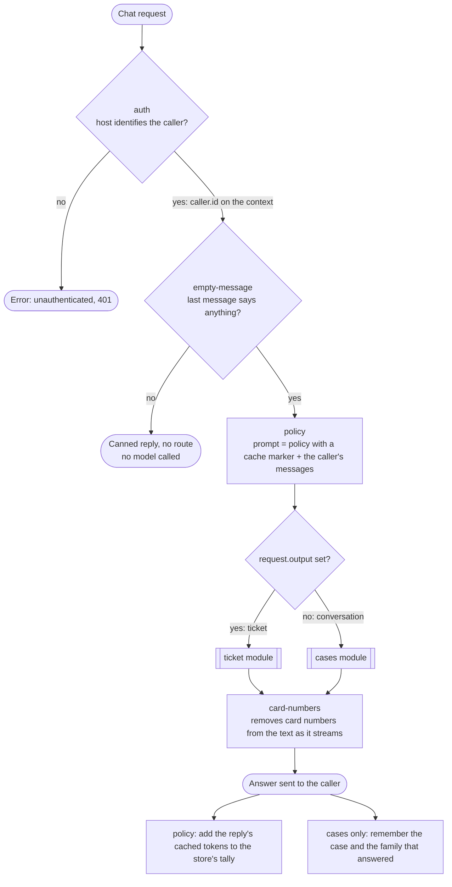
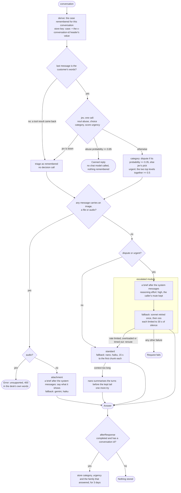
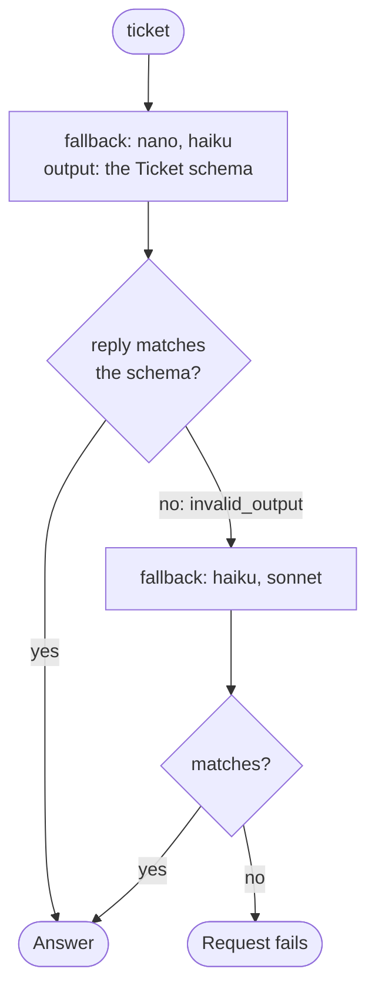

# desk

A customer-support desk for one product, served as one model, that sends each request to the model
fit for what it contains. This page follows one request through the motty; the rules behind each
step are in [ARCHITECTURE.md](../../ARCHITECTURE.md).

## The whole request

The root in `src/motty.ts` uses four parts and then routes by whether the caller asked for JSON.
A request for JSON is filed as a ticket; anything else is a conversation.

- A blank message is answered in words, by hand. An error would read as the desk being broken, and
  a customer who sent nothing has done nothing wrong.
- The policy is the first message of every prompt and never changes, so every request of every
  customer shares one cached prefix. Whatever a later step adds goes after it.
- `card-numbers` rewrites text chunks only. A tool call, its arguments, the finish reason and the
  usage pass through as the model gave them.
- A number can arrive split between two chunks, so digits that end a chunk are held until the next
  chunk shows whether they are a card number.

## A conversation: the cases module

`src/modules/cases` judges the customer's last message once, with one decision call that asks three
questions, and routes on what the conversation holds.

- One decision call answers all three questions. The thresholds sit on probabilities, and the one
  for a dispute is low on purpose: a dispute answered by a small model costs more than a plain
  question answered by a strong one.
- With the decision model down, a case stays as it was last judged, or is an ordinary one. A guess
  neither refuses a customer nor spends the strong model.
- Abuse is answered before the route, and the case is remembered by an `afterResponse` registered
  after the route. That hook reads what the route makes, so it is not run when the route never
  ran, the record lists it as `unreached`, and abuse is never remembered as a case. The
  policy's tally reads nothing a step that did not run makes, and still runs.
- Media outranks urgency, because a model that cannot see the attachment has nothing to answer
  about. Every message is checked, not the last: each turn sends the whole conversation again.
- The reader is told an attachment is there to be read. Told only to answer from the policy, it
  said in half of the eval's runs that it could not see one.
- A voice message is refused with `Unsupported` and the desk's own sentence, which reaches the
  caller as written.
- The strong path gives way to the standard one only when its models are busy. A request an
  upstream blocked would be blocked there too, so that failure is the caller's to see.
- A time limit moves on to the next model only before the first chunk. A strong model that goes
  silent halfway fails the request, because the caller already has the first half.
- The compaction runs after a model said the prompt is too long, not by counting messages: the SDK
  counts no tokens, and the upstream knows its own limit.

## Tools and families

Tools belong to the caller's agent, so the desk runs none. Three rules keep a tool loop whole:

- The prompt goes upstream as the caller sent it: tools, tool choice, and every assistant turn with
  the reasoning the model signed.
- A turn whose last message is a tool result is not triaged again. The customer said nothing new,
  so the case, the route and the family are the ones remembered.
- In every tier the model of the remembered family is asked first, whatever the operator set. A
  model goes on only from reasoning its own family signed; another family is sent the calls and
  results without it, and the call's `warnings` say so.

When that family is down, the conversation goes on with the other model of the tier, and from then
on that one's family is remembered. The summary never cuts between a tool call and its result: the
kept tail starts at a message of the customer's own words.

## JSON: the ticket module

`src/modules/ticket` reads a conversation into the desk's one ticket schema. The caller's own schema
is the signal to route on, not the shape filled.

- A ticket is not triaged: the conversation is read, not answered, and the abuse gate has nothing to
  protect.
- The schema is asked for by name and as strict. Every key of it is required and nullable, the
  form every upstream's strict mode takes.
- The reply is validated before any of it is sent, so a ticket that does not fit is filed again
  and the caller never parses half of one.

## The policy plugin

`policy(cache)` in `src/middleware/policy.ts` is written the way a plugin is: a function that takes
arguments and returns a part, with the arguments as its seed, built on the core and on `store`
alone. It reads no settings, because one settings part belongs to the served motty.

It sits in the middleware folder because it is a part with only hooks, and files follow the request:
it is one step of this request's path. Published, the same file would be a package of its own.

## Where the numbers come from

Every threshold, the first model of each tier, the time limits and the time a case is remembered
are defaults in `src/settings.ts`, and the host overrides two of them in `src/serve.ts`. The retry
count and the policy's cache lifetime are fixed in the code. The models are named in
`src/models.ts`, with the composition each role is asked through; `jev` is the decision model.

`test/` runs every branch above with scripted models. `evals/` holds two evals with real adapters,
skipped without keys. Their files do not end in `.test.ts`, so a plain `bun test` makes no paid
call; `bun run eval` runs them.
