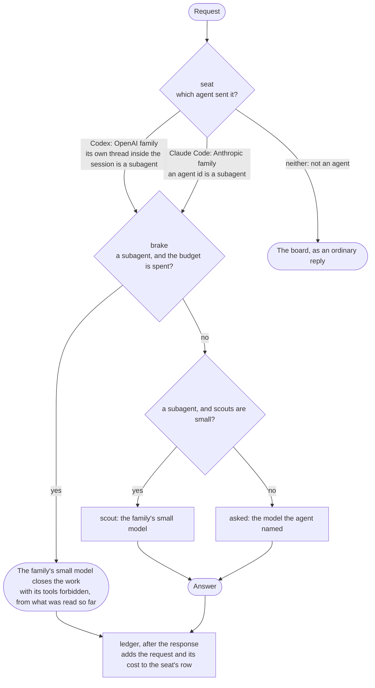

# fleet

Runs a coding agent's whole fleet of subagents through one motty. The host sees what each agent
spends, sends the subagents to a small model and closes the work of a subagent once the fleet has
spent its budget. This page follows one request through the motty; the rules behind each step are in
[ARCHITECTURE.md](../../ARCHITECTURE.md).

## The whole request

Claude Code and Codex both work, and neither needs a plugin or a setting of its own beyond the
address of the motty. Each of them says on every request which session it belongs to and whether it
is the lead or a subagent, and that is all the motty reads.



- An agent stays on its own family. Codex is answered by OpenAI models and Claude Code by Anthropic
  ones, because each sends options that only its own family takes.
- A Codex subagent is known by a thread of its own inside the lead's session, whatever model name
  Codex was started with. Nothing is decided by the tools a request declares, since Codex does not
  always declare them where a motty would see them.
- An agent started under the motty's own name asked for no model, so the lead model of its family
  answers. That is `gpt-6.1-sol` for Codex and `claude-opus-5-5` for Claude Code.
- A subagent past the budget is not cut off. The small model writes its report from what the
  subagent has read, so the lead still gets an answer and can finish. The lead is never stopped.
- The closing request keeps the tools the subagent declared and forbids their use. Anthropic
  refuses a conversation of tool calls that declares no tools, and OpenAI accepts either form.
- The ledger runs after the response, so it adds no time to an answer.

## The board

Anyone who asks the same address without being an agent gets the board as the reply, so a plain
chat request shows the fleet while it works. The board below is put together from the rows of
several real runs, so that it shows both markers at once. No single run printed it.

```text
lead        gpt-6.1-sol         7 req   $0.070  Spawn three subagents in parallel, one per file (orders.ts, payments.…
sub b644a7  gpt-6-luna          2 req   $0.002  Read only orders.ts and summarize what it does in exactly one sentenc…
sub 5c1257  gpt-6-luna          2 req   $0.001  1 FAILED Read only users.ts and summarize what it does in exactly one…
sub f65a01  gpt-6-luna          2 req   $0.001  STOPPED Read only payments.ts and summarize what it does in exactly o…
spent $0.073 of $1.000
```

- A row is a seat, the lead or one subagent, in the order the seats were first seen. It names the
  model that answered first, the requests made, what they cost and the task as the agent put it.
- `FAILED` with a count marks a seat whose requests were refused or failed, so a call that spent
  nothing is still on the board.
- `STOPPED` marks a subagent that the brake closed.
- Codex under a model name it knows starts a subagent from the lead's conversation and hides the
  subagent's own task from the motty. The row of such a subagent shows the last thing the lead's
  conversation said, which is the lead's task or the notes Codex adds about the working directory.

## Running it

The host needs `OPENAI_KEY` and `ANTHROPIC_KEY`, which Bun reads from `.env` in the repository root.
The agents are given a key that is no key, because the real ones stay with the host.

```sh
bun examples/fleet/src/serve.ts
```

Claude Code needs only the address and a key that is no key.

```sh
ANTHROPIC_BASE_URL=http://localhost:3000 ANTHROPIC_API_KEY=not-a-key \
  claude --print "Understand this repo. Use one subagent per module, in parallel."
```

Codex takes the motty as a provider, under a model name it knows or under `fleet`.

```sh
FLEET_KEY=not-a-key codex exec -m gpt-6.1-sol \
  -c 'model_provider="fleet"' \
  -c 'model_providers.fleet={name="fleet",base_url="http://localhost:3000/v1",env_key="FLEET_KEY",wire_api="responses"}' \
  "Understand this repo. Use one subagent per module, in parallel."
```

Claude Code turns on beta features in a header of Anthropic's own, and such a header travels on to
Anthropic with the body it describes, so an account without that beta may refuse the request. That
is the account's answer, not the motty's.

In a second pane `sh examples/fleet/demo/board.sh` asks for the board once a second, and takes
another address as its one word.

`bun examples/fleet/demo/demo.ts small 1 codex` does all of this in one process against a small
temporary repository and prints the board as it changes. The first word is `small`, or `asked` to
only watch, and the second is the budget. The third may be `claude` instead, and a fourth is the
model name Codex is started with.

## Where the numbers come from

The budget and the choice between `small` and `asked` are defaults in the settings, and the served
host overrides them from `BUDGET` and `SCOUTS`. With `SCOUTS=asked` each subagent stays on the model
its agent asked for, so the motty only watches. `BUDGET=5` sets what the whole fleet may spend, and
the default is 1.

A cost is what the host's `price` makes of the tokens a call reported. Its rates are this host's own
example figures in US dollars per million tokens, not a price list the SDK ships. The lead and the
small model of each family are named in the models file, and the length a task is cut to on the
board is fixed in the code. The host keeps the board in its own process, so it is empty again after
a restart.

The tests run every branch above with scripted models. The one eval has the real small model close
a stopped subagent's work and is skipped without a key. Its file does not end in `.test.ts`, so a
plain `bun test` makes no paid call, and `bun run eval` runs it.
